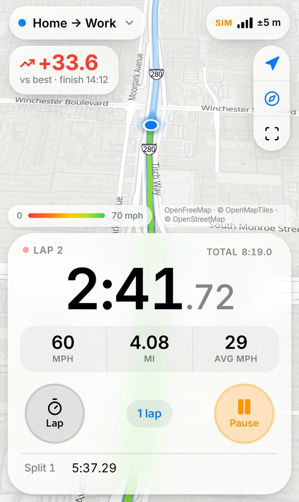
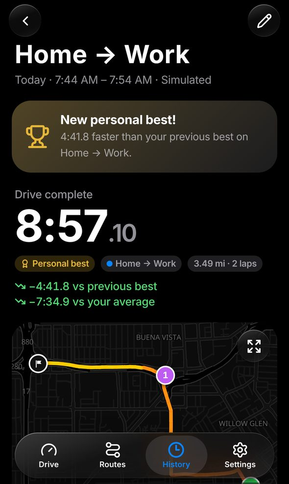
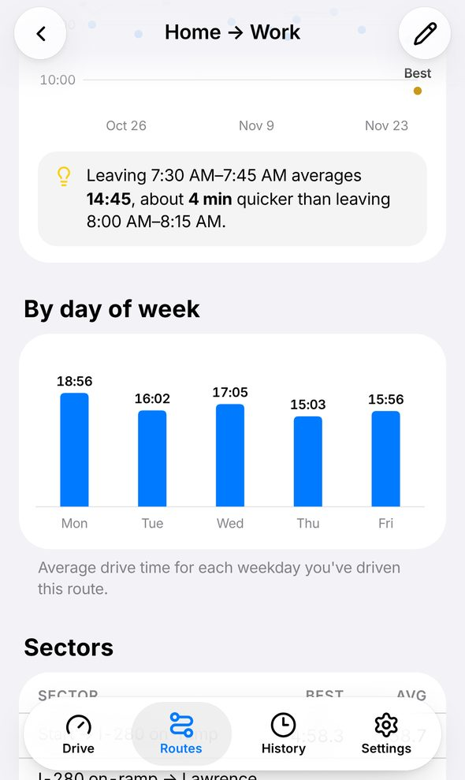
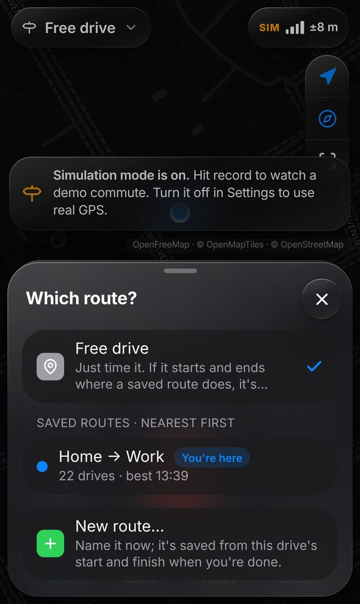

# Fury: GPS lap timer for your drives

Fury is a GPS stopwatch for the drives you repeat. Hit **record** when you set off, tap **Lap** whenever you like, and
watch your line on the map change colour with your speed: red through corners and at lights, green on the highway.
When you **finish**, you get a full breakdown of the drive. Drives that share a start and finish (like *Home → Work*)
are grouped into **routes**, so you can see your best, your average, your trend, the best time to leave, and how today
stacks up.

<p align="center">
  
  
  
  
</p>

It's an installable web app (PWA) built to look and feel like an iOS app, with Liquid Glass controls. It runs on your iPhone for
free, with **no App Store, no Apple developer account, and no Fury account**. Your data never leaves your phone.

## Put it on your iPhone

You need GitHub (where this code already lives) and Safari. Nothing else.

1. **Turn on GitHub Pages (one time).** In this repository on GitHub, open **Settings → Pages**, and under
   **Build and deployment → Source** choose **GitHub Actions**.
2. **Deploy.** Merge this branch into `main`. The *Deploy to GitHub Pages* workflow builds and publishes the app. You
   can also run it by hand from the **Actions** tab. When it finishes, the app is live at
   **https://appleorch.github.io/Fury/**.
3. **Install.** On your iPhone, open that address in **Safari**, tap **Share**, then **Add to Home Screen**. Open Fury from
   the new icon. It runs full-screen like a native app and works offline after the first load.
4. **Allow location** when asked (*While Using the App*, with *Precise Location* on). If you missed the prompt:
   *Settings → Privacy & Security → Location Services → Safari Websites → While Using the App*.

Updates deploy automatically whenever `main` changes; the app picks them up the next time you open it.

## Using it

**Drive tab**
- Tap the route button (top left) to choose a saved route, a free drive, or **New route…** to name the route you're about
  to drive. It's created from this drive's start and finish when you're done.
- The big red button starts the timer. While recording you get the current **lap time** (large), total time, speed,
  distance and average speed, plus **Lap** and **Pause** buttons. When paused you can **Resume**, **Finish**, or
  **Discard**.
- The map follows you heading-up with a speed-coloured line. The compass button switches to north-up, and the frame button
  zooms out to the whole drive.
- On a saved route, a pill at the top shows how far **ahead or behind your best run** you are right now, and your predicted
  finish time. It updates continuously using the best run's track as a "ghost".
- Route **checkpoints** give automatic splits as you drive past them, each compared with the same sector of your
  reference run.

**After a drive**, the summary shows total and moving time, stopped time and number of stops, average, moving-average and
top speed, climb, a lap table with best and slowest laps, speed along the drive, time spent at each speed, and, on a
route, your rank, the gap to your best and your average, and a sector-by-sector comparison. You can rename the drive,
save it as a route, move it to another route, export it as GPX, or delete it.

**Routes tab.** Each route shows best, average and last time with a trend line. Inside a route:
- every drive plotted by date (with a rolling average) or by **departure time**, plus a plain-language tip such as
  *"Leaving 7:30–7:45 averages 14:33, about 4 min quicker than leaving 8:00–8:15"*
- average time by weekday, consistency and weekly trend
- best and average for each sector, and your **theoretical best** (the sum of your best sectors)
- a map where you can **edit checkpoints**: tap the route line to add one, tap a checkpoint to remove it. Every past drive
  is re-split automatically.
- all drives ranked or by date, plus colour, matching radius, rename and delete

**History tab.** Every drive, grouped by month and filterable by route, with 30-day totals.

**Settings** covers units (mph or km/h), theme, the speed that counts as "fully green", a colour-blind-friendly palette,
keep screen on, haptics, spoken lap times, which run to race (best, typical or last), auto-lap at checkpoints,
auto-finish on arrival, backup export and import, and deleting your data.

### How routes are matched
A drive belongs to a route when it **starts and finishes within the route's radius** (250 m by default) of the route's
start and finish. When you finish a free drive, Fury checks your saved routes and files it automatically. If you've made
the same unassigned drive more than once, the summary suggests saving it as a route and adds the earlier drives too.

### Try it without driving
Choose **Explore with a demo drive** on first launch, or in Settings turn on **Simulation mode** and **Load sample
history**. You get a month of sample commutes and a simulated drive that plays as a time-lapse, so you can try laps,
splits, the live comparison and every statistic from the couch. Turn Simulation mode off to use real GPS.

## Good to know (iPhone web-app limits)

- **Keep the screen on while recording.** iOS pauses web apps when the screen locks or you switch apps, so GPS stops
  updating. Fury keeps the screen awake during a drive (Settings → Keep screen on). If you do lock the phone, the
  **timer keeps running**: the missing stretch is drawn as a straight line and the drive is saved normally. Mounting the
  phone and leaving Fury open works best.
- Your recording survives the app being closed. Reopen it and the drive carries on where it was.
- Data lives in the app's on-device storage. **Removing the Home Screen icon deletes it**, so use *Settings → Export backup*
  now and then. A backup is a single JSON file you can save to Files and import later.
- Set everything up before you pull away. The controls are big on purpose, but your eyes belong on the road.

## Development

```bash
npm install
npm run dev        # local dev server
npm test           # unit tests (geometry, stats, route matching, live comparison, sample data)
npm run build      # type-check and production build into dist/
npm run preview    # serve the production build
```

To try it on a phone during development, run `npm run dev -- --host` and open the printed network address. Geolocation
needs HTTPS on iOS, so for real GPS use the deployed GitHub Pages build.

Project layout:

| Path | What's there |
|---|---|
| `src/lib/` | Pure logic: geometry, GPS track cleaning, statistics, route matching and sectors, the live "ghost" comparison, formatting, sample drive simulator |
| `src/store/` | IndexedDB persistence, settings, and the recording engine (`recorder.ts`) |
| `src/components/` | Liquid Glass UI kit, MapLibre map wrapper, SVG charts |
| `src/views/` | Drive, trip summary, routes, route detail, history, settings |
| `scripts/` | Icon rendering and sample-route generation |
| `tests/` | Vitest unit tests |

Built with React, TypeScript, Vite, `vite-plugin-pwa` and MapLibre GL.

## Credits

Map data © [OpenStreetMap](https://www.openstreetmap.org/copyright) contributors. Vector tiles from
[OpenFreeMap](https://openfreemap.org) (free, no API key) using [OpenMapTiles](https://openmaptiles.org/) styles. The
demo route geometry was generated once with the [OSRM](https://project-osrm.org/) demo server.
